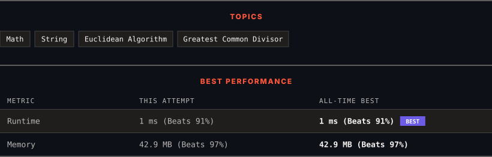

# 1071. Greatest Common Divisor of Strings

      

---

<picture>
  <source media="(prefers-color-scheme: dark)" srcset="panel-dark.svg">
  <source media="(prefers-color-scheme: light)" srcset="panel-light.svg">
  
</picture>

> **New personal best** — Runtime improved on this submission.

### HOW IT WENT

| | |
|:--|:--|
| **Attempts** | first try |
| **Time to solve** | 11 min |
| **Verdicts** | ✅ Accepted |

---

### NOTES

_No notes yet._

---

### SOLUTIONS (1)

| # | File | Language | Date |
|:-:|------|:--------:|:----:|
| 1 | [sol1.java](./sol1.java) | `Java` | 2026-10-24 ← **latest** |

---

### PROBLEM DESCRIPTION

For two strings `s` and `t`, we say "`t` divides `s`" if and only if `s = t + t + t + ... + t + t` (i.e., `t` is concatenated with itself one or more times).

Given two strings `str1` and `str2`, return *the largest string *`x`* such that *`x`* divides both *`str1`* and *`str2`.

 

**Example 1:**

**Input:** str1 = "ABCABC", str2 = "ABC"

**Output:** "ABC"

**Example 2:**

**Input:** str1 = "ABABAB", str2 = "ABAB"

**Output:** "AB"

**Example 3:**

**Input:** str1 = "LEET", str2 = "CODE"

**Output:** ""

**Example 4:**

**Input:** str1 = "AAAAAB", str2 = "AAA"

**Output:** ""​​​​​​​

 

**Constraints:**

	- `1 <= str1.length, str2.length <= 1000`

	- `str1` and `str2` consist of English uppercase letters.

---

Auto-synced by <strong>LeetSync</strong> · Built by <a href="https://deveshsamant.in/">Devesh Samant</a>

