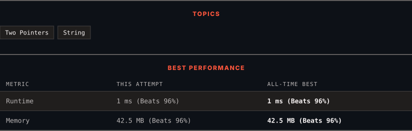

<div align="center">

# 1768. Merge Strings Alternately

      

[](https://leetcode.com/problems/merge-strings-alternately/)

</div>

---

<div align="center">

<picture>
  <source media="(prefers-color-scheme: dark)" srcset="panel-dark.svg">
  <source media="(prefers-color-scheme: light)" srcset="panel-light.svg">
  
</picture>

</div>

> **New personal best** — Runtime improved on this submission.

### HOW IT WENT

| | |
|:--|:--|
| **Attempts** | first try |
| **Time to solve** | under a minute |
| **Verdicts** | ✅ Accepted |

---

### NOTES

_No notes yet._

---

### SOLUTIONS (1)

| # | File | Language | Date |
|:-:|------|:--------:|:----:|
| 1 | [sol1.java](./sol1.java) | `Java` | 2026-10-23 ← **latest** |

---

### PROBLEM DESCRIPTION

You are given two strings `word1` and `word2`. Merge the strings by adding letters in alternating order, starting with `word1`. If a string is longer than the other, append the additional letters onto the end of the merged string.


Return *the merged string.*


 


**Example 1:**


```

**Input:** word1 = "abc", word2 = "pqr"
**Output:** "apbqcr"
**Explanation:** The merged string will be merged as so:
word1:  a   b   c
word2:    p   q   r
merged: a p b q c r

```


**Example 2:**


```

**Input:** word1 = "ab", word2 = "pqrs"
**Output:** "apbqrs"
**Explanation:** Notice that as word2 is longer, "rs" is appended to the end.
word1:  a   b 
word2:    p   q   r   s
merged: a p b q   r   s

```


**Example 3:**


```

**Input:** word1 = "abcd", word2 = "pq"
**Output:** "apbqcd"
**Explanation:** Notice that as word1 is longer, "cd" is appended to the end.
word1:  a   b   c   d
word2:    p   q 
merged: a p b q c   d

```


 


**Constraints:**


	- `1 <= word1.length, word2.length <= 100`

	- `word1` and `word2` consist of lowercase English letters.

---

<div align="center">

<sub>Auto-synced by <strong>LeetSync</strong> · Built by <a href="https://deveshsamant.in/">Devesh Samant</a></sub>

</div>
